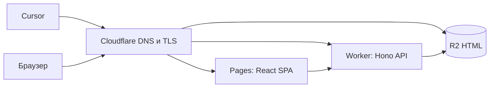

# Stage 0 — прототип

**Статус:** план прототипа. Не замена Stage 1.
**Дата:** 2026-09-23
**Рядом:** [constitution.md](./constitution.md), [prd.md](./prd.md), [contracts.md](./contracts.md), [tech-spec.md](./tech-spec.md), [ux-spec.md](./ux-spec.md)

Stage 0 проверяет одну петлю на себе: агент в Cursor кладёт HTML через MCP, документ появляется в списке, получатель открывает стабильный URL, повторная запись меняет тело и не меняет адрес.

Мультиарендности нет. Аккаунтов, приглашений, общей папки и выбора слага нет. Один заранее заданный workspace, один ключ MCP.

Этот файл не меняет конституцию, PRD, contracts и tech spec. Они остаются спецификацией Stage 1. Прототип можно выбросить, когда петля понятна.

---

## Зачем отдельно от Stage 1

Stage 1 — продукт: magic link, membership, инвайты, два боевых контура, Postgres, Hono. Пока этого нет, непонятно, удобно ли вообще класть документ из Cursor и жить с одним URL.

Stage 0 отвечает только на это. Если петля не нравится, Stage 1 не начинаем.

---

## Что считается готовым

Прототип закрыт, когда с машины автора, без своего сервера, выполняется сценарий:

1. В Cursor подключён MCP по `https://{host}/mcp` с одним bearer-ключом.
2. Агент вызывает `put_document` с именем `cv` и HTML.
3. В списке на `https://{host}/` появляется строка `cv` с каноническим URL.
4. Этот URL открывается без входа и отдаёт документ.
5. Второй `put_document` с тем же именем меняет содержимое. Путь тот же.
6. `delete_document` убирает строку из списка. Тот же URL отвечает 404.
7. В публичном HTML остаётся авторский `<script>`. Санитизацию откладываем до Stage 1.

Один человек, одна папка, несколько документов. Второго пользователя нет.

---

## В скоупе

- Одно приложение на Hono в Cloudflare Workers: список документов, публичная выдача, MCP.
- Четыре tools: `list_documents`, `put_document`, `get_document`, `delete_document`. Имена и форма ошибок — как в contracts, чтобы Stage 1 не переучивал агента.
- Один workspace. Слаг и ключ — секреты деплоя, не экраны продукта.
- Хранение на Cloudflare: только R2 (и тела HTML, и метаданные через ключи). Базы данных (D1/Postgres) в прототипе нет.
- Рантайм — Cloudflare Workers (бесплатный тариф).
- DNS, TLS — Cloudflare.

## Вне скоупа

Не делать в прототипе, даже «на час»:

- аккаунт, сессия, magic link, почта
- invite, member, owner, switcher, второй workspace
- drop, paste, Replace, Duplicate, Rename в UI
- Settings, регенерация ключа, плашка Free, OG, свой домен
- Postgres, DigitalOcean, Yandex Cloud, Docker Compose как боевой контур
- свой ИИ, редактор, markdown, git, шаблоны
- `publish`, `deploy`, preview URL

Запись в папку на этом этапе — только MCP. Список в браузере читает то, что уже лежит.

---

## Что прототип всё же соблюдает

Иначе это будет хостинг скриптов, а не папка.

| Правило | Как в Stage 0 |
| --- | --- |
| Save = live | Успешный `put_document` сразу виден по URL. Черновика нет |
| Имя = сегмент пути | `cv` → `https://{slug}.{host}/cv`. Без `.html` |
| Replace не меняет URL | Повторный `put_document` с тем же именем |
| MCP — диск | В ответе публичный URL. Tools `publish` / `deploy` нет |
| Выдача не исполняет JS | В Stage 0 **исполняет**. Отдаём из R2 напрямую. Санитизация — работа Stage 1 |
| Один формат | Только HTML |
| Apex — не пространство документов | Список и MCP на `{host}`. Документ на `{slug}.{host}` |

Слаг один и задан нами. Человек его не выбирает. Это сознательное сужение инварианта «workspace создаёт пользователь», не новая модель URL.

Полная санитизация, CSP и OG из contracts на прототипе не обязательны. В Stage 0 скрипты автора **могут** исполняться на публичной странице, так как файлы отдаются напрямую из R2. Довести выдачу до contracts — работа Stage 1.

---

## Форма системы

Два приложения (фронтенд и бэкенд), один бакет.

```text
https://{host}/                      список (React SPA)
https://api.{host}/mcp               MCP, Streamable HTTP
https://api.{host}/api/documents     REST API для списка
https://{slug}.{host}/{name}         публичный документ (прямо из R2)
```

`{slug}` — константа окружения, например `demo`. Отдельный DNS-record на этот лейбл, не wildcard на все слаги: других workspace нет.



Worker (Hono) обслуживает только MCP и REST API.
Публичные документы отдаются **напрямую из R2** через привязанный Custom Domain (`{slug}.{host}`).

Cookie и логина нет. Список на `{host}` открыт тому, кто знает адрес. Это dogfood, не запуск. Ключ MCP в списке не показываем.

---

## Приложение Hono (Worker)

Один процесс, две зоны.

| Зона | Зачем |
| --- | --- |
| Documents | Запись и чтение одной папки: всё напрямую в R2 |
| Mcp | `POST /mcp`, stateless. Bearer-ключ сверяется с секретом. Четыре tools зовут Documents |
| Api | `GET /api/documents` — JSON для фронтенда. |

Модули auth, mail, workspace, membership не заводим. Фильтр «чей workspace» не нужен: папка одна.

Санитизации в Stage 0 нет: документ отдаётся из R2 «как есть». Это сознательное упрощение для прототипа.

---

## Фронтенд (Cloudflare Pages)

React SPA (Vite), стилизация — Tailwind CSS + shadcn/ui.

Список, колонки как в ux-spec, но короче:

1. Name
2. Modified
3. URL — клик копирует канонический адрес
4. Open — та же публичная страница, не iframe

Пустой список: короткая фраза, что документ кладёт агент через MCP. Кнопки загрузки нет.

Язык строк UI — английский, как в Stage 1.

---

## Данные

В Stage 0 базы данных нет. Всё хранится в R2. Это радикально упрощает прототип и позволяет остаться на бесплатном тарифе Cloudflare Workers.

**R2**, один бакет. Объект = оригинальный HTML после ingest. Ключ = `name`. Метаданные (размер и дата загрузки) хранятся и отдаются самим R2.

Порядок `put_document`:

1. Проверить имя и что тело не пустое.
2. Положить HTML в R2 (`R2.put`).

`delete_document`: удалить объект R2. Имя можно занять снова.

`get_document` читает R2, не публичный ответ.

`list_documents` делает `R2.list()`. R2 возвращает массив ключей с их размерами и датами загрузки. Приложение сортирует этот массив по дате в памяти (для 30 документов это мгновенно) и отдаёт клиенту.

Лимиты прототипа, не лимиты Free из contracts:

| Лимит | Значение |
| --- | --- |
| Документов | 30 |
| Размер одного HTML | 2 MiB |

Ограничение в 2 MiB оставлено для скорости и защиты прототипа. 5 MiB и 50 документов — забота Stage 1.

Имена: те же правила, что в contracts (нижний регистр, без `.html` после одной нормализации). Чужой грамматики не изобретаем.

---

## MCP и Cursor Skill

Транспорт: Streamable HTTP, один `POST` на вызов, сессию SSE не держим. Заголовок `Authorization: Bearer {key}`. Ключ лежит в секрете Worker. Перевыпускать некому, смена ключа — смена секрета и редеплой.

| Tool | Поведение |
| --- | --- |
| `list_documents` | Имена, URL, `updated_at`, `bytes`. Без HTML. Сортировка по `updated_at` desc. `workspace` в ответе — наш фиксированный слаг |
| `put_document` | Создать или заменить. В ответе канонический URL |
| `get_document` | Оригинал из R2 |
| `delete_document` | Сразу, без подтверждения. Ключ и есть полномочие |

Коды ошибок из contracts, которые реально возникают: `unauthorized`, `invalid_name`, `not_found`, `limit_exceeded`, `invalid_html`, `bad_request`. Коды membership и invite не возвращаем: таких операций нет.

`duplicate_document` нет. Нужна копия — агент пишет новое имя сам.

### Cursor Skill

Чтобы агент понимал, как пользоваться MCP, в прототипе создаётся локальный файл `.cursor/skills/web-docs/SKILL.md`. 
Его задачи:
1. Запретить агенту сохранять HTML локально на диск.
2. Обязать вызывать `list_documents` перед созданием, чтобы не затереть чужой файл.
3. Задать правила вёрстки (Tailwind CDN, Google Fonts, отсутствие локальных картинок).
4. Обязать выводить кликабельный URL из ответа `put_document` в чат пользователю.

---

## Cloudflare

Всё, что живёт у получателя и у агента, в одном аккаунте Cloudflare.

| Задача | Сервис |
| --- | --- |
| DNS и TLS | Зона Cloudflare. Записи `{host}` и `{slug}.{host}`, proxied. SSL Full (strict) |
| Приложение | Cloudflare Pages (React) + Cloudflare Workers (Hono). Кэш документов выключен |
| Хранение | R2 (и метаданные, и тела HTML) |
| Секреты | MCP-ключ, `WORKSPACE_SLUG` |

Почему Worker и Hono. Это бесплатно, быстро и нативно для Cloudflare. Hono имеет прямой доступ к R2 через bindings (`env.BUCKET.put()`), без HTTPS-запросов и токенов.

Боевой hostname по-прежнему открыт (вопрос PRD). Для прототипа достаточно любой своей зоны; грамматика `{slug}.{host}/{name}` от имени зоны не меняется.

Ориентир денег: 0$. Бесплатный тариф Workers и R2 с запасом покрывает нужды прототипа.

---

## Порядок работ

Кода в этом документе нет. Порядок такой, чтобы каждый шаг уже можно было потрогать.

1. **Аккаунт Cloudflare.** Зона, пустой бакет R2, секрет ключа MCP.
2. **Worker на Hono.** Отвечает `GET /api/documents` «пусто».
3. **Documents.** `put` / `list` / `get` / `delete` напрямую против R2. Проверка тем же процессом, без UI.
4. **MCP и Skill.** Четыре tools поверх Documents. Подключение из Cursor. Написание `SKILL.md` для агента. Первый `put_document` с ноутбука.
5. **Фронтенд (Pages).** React SPA на `{host}` читает `GET /api/documents`. Open ведёт на субдомен.
6. **Выдача.** Привязка Custom Domain (`{slug}.{host}`) к бакету R2. Кэш сбрасывается через Cache Rules.
7. **Сценарий готовности** из начала файла, один раз руками из Cursor.

Шаг 2 не пропускать: если Host не работает, остальное будет локальной иллюзией.

Локально приложение можно запускать через Wrangler против того же R2 (удалённо) или локального симулятора.

---

## Что не переносим в Stage 1

Когда петля подтверждена, прототип не «доращиваем» до PRD.

| В прототипе | В Stage 1 |
| --- | --- |
| Только R2 | Postgres (метаданные) + R2/S3 (тела HTML) |
| Cloudflare Workers (Hono) | Hono (Docker/Node.js) или Workers + Postgres |
| Один слаг в секрете | Аккаунт, onboarding, субдомен на workspace |
| Открытый список | Сессия, членство, общая папка |
| Четыре tools | Пять tools из contracts, плюс UI |
| Прямая отдача из R2 | Worker-прокси, санитизация, CSP |

Удачный прототип сам по себе spec не переписывает. Stage 1 по-прежнему требует базы данных для сложной логики аккаунтов и инвайтов.
