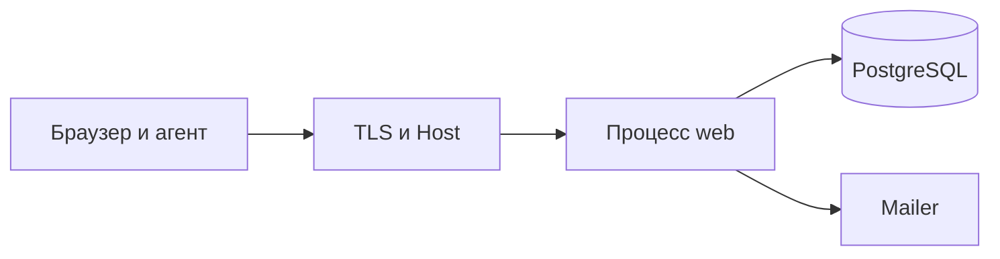

# Tech spec — Web Docs Stage 1

**Статус:** архитектура запуска. Не vision и не смета.
**Источник:** [constitution.md](./constitution.md), [contracts.md](./contracts.md), [prd.md](./prd.md)
**Дата:** 2026-09-22

Слоган продукта не меняется: Keep the document. Этот файл выбирает технологии и форму деплоя. Имена, URL, MCP, HTML policy и лимиты остаются в contracts. Если здесь и в contracts расхождение — прав этот файл или contracts явно, не «как удобнее в облаке».

---

## Решение

Один процесс, один Docker-образ, одна база.

| Слой | Технология |
| --- | --- |
| Язык | TypeScript, Node.js 22 |
| HTTP | [Hono](https://hono.dev) |
| База | PostgreSQL 16. Метаданные и оригинал HTML в одной БД |
| Доступ к БД | `pg` + SQL-миграции (Drizzle) |
| MCP | `@modelcontextprotocol/sdk`, транспорт Streamable HTTP, stateless |
| Почта | интерфейс `Mailer`. Реализация зависит от контура |
| UI | серверный HTML. Отдельного SPA, React и своего фронтенд-хоста нет |

Два боевых контура поднимают **этот же образ**. Выбор контура не меняет схему, URL и MCP.

| Контур | Когда его брать |
| --- | --- |
| **Yandex Cloud**, регион `ru-central1` | Данные и почта в РФ, один вендор, 152-ФЗ. Дороже на пустом ходе из‑за Managed PostgreSQL |
| **Cloudflare + DigitalOcean** | Минимальный счёт и глобальный TLS. Почта — внешний Resend. Данные вне РФ |

Чистый Cloudflare Workers и Yandex Serverless Containers в Stage 1 не используем. Почему — в разделе «Отклонённые упаковки».

Design document (Markdown как исходник, PDF, свой домен, пароль, аналитика открытий) в эту спецификацию не входит. Конституция, инвариант 9: один формат — HTML. Пока инвариант не снят отдельной датой, рендерер Markdown и генератор PDF не проектируем.

---

## Форма системы

Два публичных входа, один origin приложения.

```text
https://{host}                  приложение: логин, список, settings, invite, MCP
https://{workspace}.{host}/{name}   публичная выдача одного документа
```



Процесс читает заголовок `Host`:

| Host | Что отвечает |
| --- | --- |
| `{host}` | Страницы, формы, сессия, `POST /mcp` |
| ровно один лейбл + `.{host}` | Только `GET /{name}`, `GET /` → 404, `GET /{name}/` → 301 без слэша |
| что-то ещё (`a.b.{host}`, IP) | 404, без листинга |

`www.{host}` — обычный workspace со слагом `www`, не редирект на apex. Reserved-слагов нет.

Cookie сессии — **host-only** на `{host}`. `Domain=.{host}` запрещён: сессия утекла бы на все субдомены документов.

Публичный GET не кэшируем на CDN. Contracts требуют `Cache-Control: no-cache`: Replace должен быть виден следующим запросом. На Cloudflare для `*.{host}/*` — Cache Rule bypass. Yandex CDN перед документами не ставим.

HTTP → HTTPS делает край (балансировщик, Cloudflare или App Platform), не приложение.

---

## Процесс `web`

Один бинарник, три роутера.

### Apex

Серверные страницы из [ux-spec.md](./ux-spec.md): `/`, `/login`, `/onboarding`, `/settings`, `/invite/{token}`. Мутации — `POST` формы на apex. Отдельного JSON API для UI нет: список читает Postgres в том же запросе.

Open из списка — ссылка на канонический URL субдомена, не iframe и не второй рендер.

### Выдача документа

На `GET https://{workspace}.{host}/{name}`:

1. Найти workspace по слагу и документ по имени.
2. Нет строки или имя не по грамматике — HTML 404 продукта, без списка чужих имён. Не 403.
3. С **копии** тела собрать выдачу: санитизация, OG, плашка Free.
4. Оригинал в БД не менять.

Санитизация — свой проход по DOM (`parse5`), не универсальный WYSIWYG-санитайзер. Правила вырезания и CSP — дословно из contracts. Плашка вставляется перед `</body>` только в эту копию.

Заголовки ответа: `Content-Type: text/html; charset=utf-8`, CSP из contracts, `X-Robots-Tag: noindex, nofollow`, `Cache-Control: no-cache`.

### MCP

`https://{host}/mcp`. Stateless Streamable HTTP: каждый вызов — `POST` с JSON-RPC, сессии SSE не держим.

Авторизация: `Authorization: Bearer {key}`. На диске только SHA-256 ключа. Ключ один на workspace. Пять tools из contracts, без `publish` / `deploy` / `rename_document`.

`get_document` отдаёт оригинал из колонки `html`. Публичный GET отдаёт другую копию. Это разные пути в коде, не флаг «иногда санитизировать».

---

## Данные

PostgreSQL — единственный source of truth Stage 1. Object Storage / R2 / Spaces для HTML не используем: Rename и Replace должны быть одной транзакцией, а лимит Free (50 документов × 5 MiB) для Postgres обычный объём. Вынос тела в объектное хранилище — отдельное решение, когда бэкапы или TOAST станут болью, не Stage 1.

### Таблицы

Имена полей совпадают с логической моделью contracts.

| Таблица | Ключ | Заметки |
| --- | --- | --- |
| `account` | `id` uuid | `email` unique, lowercase |
| `session` | `id` | `account_id`, `current_workspace_id` nullable, `expires_at` |
| `magic_link` | hash токена | одноразовый, TTL 15 минут, сырой токен только в письме |
| `workspace` | `id` | `slug` unique, `mcp_key_hash` |
| `membership` | `(workspace_id, account_id)` | `role` = `owner` \| `member`. Не больше одного `owner` на account |
| `invite` | hash токена | `expires_at` = 7 суток, resend обновляет ту же строку |
| `document` | `(workspace_id, name)` | `html` text — оригинал, `bytes` int, `link_copied_at` nullable |

`document.html` хранит байты после ingest (включая обёртку фрагмента без `<html>`). Размер проверяем по UTF-8 до записи: больше 5 MiB → `limit_exceeded`, строка не меняется.

Лимит 50 документов и 20 членов (owner + members + pending) считается в той же транзакции, что и вставка.

Одновременный Replace: последняя успешная транзакция выигрывает. Optimistic lock не нужен.

### Секреты в БД

MCP-ключ, magic link и invite token: 32 случайных байта, в БД только SHA-256. Регенерация MCP-ключа — `UPDATE` хеша в той же транзакции, старый ключ отваливается сразу.

---

## Почта

Интерфейс один: `send({ to, subject, text })`. Два письма: magic link и invite. Ссылка всегда на apex (`https://{host}/login/verify?token=…`, `https://{host}/invite/{token}`), никогда на субдомен workspace.

| Контур | Реализация |
| --- | --- |
| Yandex Cloud | Yandex Cloud Postbox, HTTPS API `https://postbox.cloud.yandex.net` (совместим с SES). Домен отправителя в Postbox: SPF, DKIM, DMARC |
| Cloudflare + DigitalOcean | [Resend](https://resend.com), HTTPS API. Тот же интерфейс `Mailer` |

Письмо не содержит HTML документа и MCP-ключ.

---

## Контур A — Yandex Cloud

Регион `ru-central1`. Каталог один.

| Задача | Сервис |
| --- | --- |
| DNS | Yandex Cloud DNS. `A`/`AAAA` на `{host}` и `*.{host}` → адрес балансировщика |
| TLS | Certificate Manager, Let's Encrypt, проверка **DNS-01**. Имена: `{host}` и `*.{host}`. На `_acme-challenge` — CNAME-делегирование в Certificate Manager, чтобы продление шло само. HTTP-01 wildcard не выпускает |
| Вход HTTPS | Application Load Balancer. Два virtual host: apex `{host}` и wildcard `*.{host}` (authority balancer это умеет). Оба ведут в одну backend group |
| Приложение | Одна ВМ Compute Cloud, 2 vCPU / 2 ГБ RAM, Docker, образ из Container Registry. Слушает HTTP только во внутренней сети. Публичного IP у ВМ нет |
| База | Managed Service for PostgreSQL 16, **один** хост, диск 10–20 ГБ network SSD, бэкапы включены. Доступ только из той же VPC. Для публичного запуска — класс с 100% vCPU (линейка `s2.micro`: 2 vCPU, 8 ГБ, или актуальный аналог). Для закрытого dogfood допустим `b2.medium` (доля vCPU 50%): в документации Yandex это тестовый класс, не прод |
| Секреты | Lockbox: `DATABASE_URL`, ключ Postbox, секрет подписи cookie. ВМ читает Lockbox сервисным аккаунтом |
| Почта | Postbox |
| Логи | Cloud Logging, JSON stdout контейнера |
| Реестр | Container Registry |

Почему не Serverless Containers + API Gateway: API Gateway сажает приложение на конкретные домены. Workspace — это субдомен, который человек выбирает при onboarding. Шлюз не становится wildcard-origin для произвольных слагов. Балансировщик с virtual host `*.{host}` эту задачу закрывает, serverless-контейнер ему бэкендом не служит.

Почему не CDN: выдача персональная по имени файла и должна меняться на Replace без инвалидации. Кэш на краю здесь баг.

Ориентир денег, не оферта. Пример из тарифа Managed PostgreSQL (Intel Ice Lake, 2 vCPU 100%, 8 ГБ, август 2026): около 7,8 ₽/час за вычислительные ресурсы одного хоста, то есть порядка 6 000 ₽/месяц плюс диск. Сверху ВМ, балансировщик, Postbox и трафик. Исходящий трафик: первые 100 ГБ/месяц не тарифицируются. Пустой Stage 1 упирается в хост Postgres, не в CPU приложения.

---

## Контур B — Cloudflare + DigitalOcean

Тот же Dockerfile. Postgres тот же.

| Задача | Сервис |
| --- | --- |
| DNS и прокси | Cloudflare. Записи `{host}` и `*.{host}` — proxied. Cache Rule: bypass на `*.{host}/*`. SSL mode Full (strict) |
| TLS до браузера | Cloudflare, универсальный сертификат на зону, включая wildcard |
| Приложение | DigitalOcean App Platform, один service из Dockerfile. Регион `FRA1` (ближе к РФ, чем `NYC`). Инстанс 1 vCPU / 1 ГБ достаточно для Stage 1 |
| Wildcard до origin | App Platform умеет wildcard domain (`*.{host}` вместе с apex). Сертификат origin выпускается по TXT. В app spec wildcard **не** используется как subdomain routing по компонентам: оба хоста идут в один service, Host разбирает приложение |
| База | Managed Postgres, 1 ГБ RAM, один узел, бэкапы платформы. Приложение ходит по VPC / trusted sources, не по открытому `0.0.0.0/0` |
| Секреты | env App Platform |
| Почта | Resend |
| Логи | логи App Platform, JSON stdout |
| Spaces | не используем |

Cloudflare здесь — DNS, TLS и защита края, не рантайм приложения. Кэш HTML выключен, иначе Replace врёт получателю.

Ориентир денег: App Platform basic порядка $5–12/месяц, Managed Postgres 1 ГБ порядка $15/месяц, Cloudflare на бесплатном плане как прокси, Resend — бесплатный транзакционный лимит, пока писем мало. Пол порядка $20–30/месяц против нескольких тысяч рублей на Yandex за счёт отказа от managed-хоста на 8 ГБ RAM.

Данные при этом в датацентре DigitalOcean (ЕС или США), не в `ru-central1`. Для корпоративной папки с офертами это может быть стоп-фактор. Тогда контур A.

---

## Отклонённые упаковки

### Только Cloudflare Workers

Workers хорошо садятся на wildcard (`*.{host}/*` + proxied DNS) и дёшевы ($5/месяц Workers Paid). Для Stage 1 не берём:

| Ограничение | Факт |
| --- | --- |
| D1, строка | максимум 2 MB. Лимит документа — 5 MiB |
| D1, SQL statement | максимум 100 KB. Тело HTML в `INSERT` не пролезает |
| Следствие | метаданные в D1, оригинал в R2. Две записи, нет одной транзакции на Replace / Rename / Delete |
| Почта | своего transactional email нет, всё равно Resend |
| Рантайм | это не Docker-образ. Санитизация 5 MiB на CPU Workers — отдельный бюджет, free plan (10 ms CPU) не подходит |

Имеет смысл позже как edge только для публичного GET, если origin остаётся Postgres. Не как первая база.

### Yandex Serverless Containers

Холодный старт и посекундная тарификация для редкого MCP выглядят привлекательно. Вход с произвольным `workspace.{host}` они не дают: перед ними нет wildcard virtual host. Пока документы живут на субдоменах, нужен балансировщик или ВМ с сертификатом `*.{host}`. ВМ за балансировщиком проще одного serverless-контейнера плюс отдельный TLS-слой.

### DigitalOcean без Cloudflare

App Platform сам выпускает wildcard-сертификат. Cloudflare не обязателен для корректности. Имеет смысл оставить его прокси: единый TLS до браузера, WAF, и тот же DNS, если позже появится свой домен Pro через Cloudflare for SaaS. Без оранжевого облака контур B тоже валиден — просто DNS и сертификат целиком на DigitalOcean.

### Kubernetes

На Stage 1 один процесс и одна база. Managed Kubernetes, ALB Ingress и cert-manager — лишняя операционка. Тот же Certificate Manager на балансировщике закрывает wildcard без кластера.

---

## Сравнение

| | Yandex Cloud | Cloudflare + DigitalOcean |
| --- | --- | --- |
| Образ приложения | Docker, Node 22 | тот же |
| База | Managed PostgreSQL, `ru-central1` | Managed Postgres, `FRA1` |
| Где байты HTML | колонка `document.html` | та же колонка |
| Wildcard `*.{host}` | ALB virtual host + Certificate Manager DNS-01 | Cloudflare proxy + wildcard domain App Platform |
| Кэш документов | нет CDN | Cache Rule bypass |
| Magic link | Postbox, контур РФ, 152-ФЗ | Resend, вне РФ |
| Секреты | Lockbox | env App Platform |
| Пол пустого Stage 1 | тысячи ₽/месяц, в основном хост Postgres | около $20–30/месяц |
| Латентность получателя в РФ | датацентр Яндекса | Франкфурт + сеть Cloudflare, обычно достаточно для HTML |
| Латентность получателя вне РФ | один регион | край Cloudflare, origin всё равно во Франкфурте |
| Self-hosted Enterprise | тот же образ и Postgres на ВМ заказчика | Workers так не переносятся; этот контур переносится |
| Свой домен Pro (не Stage 1) | ещё один сертификат и virtual host на балансировщике | естественно ложится на Cloudflare for SaaS |

Код, миграции и тесты пишем так, чтобы смена контура была сменой env и `Mailer`, не переписыванием диска.

---

## Наблюдаемость и ограничения процесса

Один инстанс в Stage 1. Горизонтально не масштабируем, пока нет метрики. Лимитер magic link (например, 5 писем на email в час) живёт в Postgres, не в памяти процесса: иначе второй инстанс его забудет.

В логи не пишем: HTML документа, MCP-ключ, сырые токены, cookie. Пишем: `workspace_id`, `document name`, код ошибки, latency.

Бэкап — средства managed Postgres выбранного контура. Отдельный снапшот «версий документа» не делаем: версия продукта — это Duplicate, другая строка.

---

## Локально и в тестах

Локально: Docker Compose, Postgres 16, `Mailer` пишет письмо в stdout. Приложение слушает `:3000` и различает хосты через `Host` (`webdocs.localhost` и `dk.webdocs.localhost`). Wildcard на localhost браузер решает через `/etc/hosts` или `*.localhost`, где это поддерживается.

Инварианты из contracts (раздел «Инварианты для тестов») — интеграционные тесты на Postgres, не мок диска. Публичный GET со `<script>` не содержит script в теле ответа; `get_document` тот же script возвращает.

Прод-сервер из репозитория не запускаем ради просмотра вёрстки. Статические макеты, если появятся, открывает Live Server.

---

## Вне этой спецификации

Не строить в том же деплое: пароль на документ, unlisted, счётчик открытий, custom domain, снятие плашки, TTL ссылки, Markdown-рендер, PDF, редактор, свой чат, шаблоны Stage 2, второй owned workspace, передачу ownership, загрузку ассетов, Redis, очередь, Kubernetes, CDN перед HTML.

Свой домен и снятие плашки — оффер Pro. Когда до них дойдёт, добавляется таблица доменов и второй сертификат. Диск документов и URL `{workspace}.{host}/{name}` остаются.
